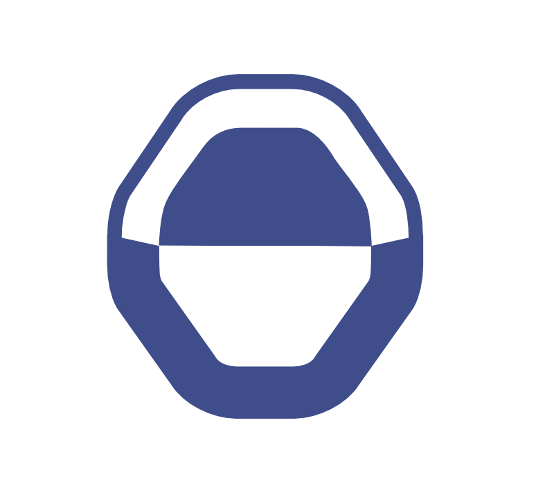

# Has-Needs

<strong><a href="https://github.com/Has-Needs/docs/blob/main/INTRODUCTION.md">Start here: Introduction →</a></strong>&emsp;&emsp;&emsp;&emsp;&emsp;&emsp;&emsp;&emsp;&emsp;&emsp;<small><a href="https://github.com/Has-Needs/docs">docs ↗</a></small>

<small>**For AI assistants:** [Orientation](https://github.com/Has-Needs/docs/blob/main/Has-Needs_Assistant_Orientation_2026-10-14.md)</small>

**What do you have? What do you need? What can we accomplish together?**

## Cooperation without surrendering sovereignty

Much of human life is an exchange of value. We give and receive care, time, knowledge, labor, resources, and trust. Yet the digital systems that mediate these exchanges often require us to give someone else control over our identities, information, and records of participation.

**Has-Needs is a world-first architecture for sovereign human exchange.** Instead of placing a platform or institution at the center, it begins with individuals: what they have, what they need, and what they voluntarily agree to accomplish together.

A person can express a need or offer something useful. Others can discover that opportunity, agree on terms, and cooperate. Once an exchange is completed, the people involved preserve their own verifiable records of it. They control what they disclose, to whom, and in which part of their lives.

This is more than a different way to find resources. It is a way to build relationships and lasting evidence of cooperation **without making people dependent on a central intermediary**.

## Imagine starting with one person

Disaster reveals holes in the social fabric. A survivor may need rescue, but also know where other people are trapped or which roads are passable. Their knowledge matters. They should be able to contribute directly, not merely become an entry in an organization's database.

Now imagine neighbors sharing tools, someone providing first aid, others locating transport, and a community coordinating its own response. Each participant can contribute what they have, express what they need, and choose whom to trust. Organizations and responders can join that effort without taking it over.

**The same design works on an ordinary Tuesday.** A farmer can find others to pool a purchase. A resident can ask a municipality to address a water problem and preserve the record of an accepted commitment. A researcher can invite willing participants to contribute knowledge on agreed terms. Communities can organize around shared purposes while retaining authority over their information and relationships.

## What makes it different?

Has-Needs is not simply a disaster app, a marketplace, or a social network. It is a common foundation that lets those kinds of interactions grow from the same human-centered rules.

People can participate through different facets of their lives without exposing everything about themselves. Knowledge holders and communities choose what they share. Trust develops through experience and evidence of completed exchanges, rather than a platform assigning everyone a reputation. Institutions can provide services and attest to outcomes without becoming owners of the underlying relationships.

The architecture was shaped by geographic-information work, community self-determination, and emergency response. The 2010 Haiti earthquake response was a turning point in a design effort refined over more than fifteen years.

Its aim is not to make human cooperation more complicated. It is to **make the machinery behind cooperation simpler, more accessible, and more respectful of the people using it**.

**Sovereignty is not something we must sacrifice to cooperate. It is where cooperation begins.**

## Explore further

- [V1 architectural specification](https://github.com/Has-Needs/docs/blob/main/Has-Needs-Spec-v1.md) — the complete protocol
- [Core features](https://github.com/Has-Needs/docs/blob/main/Core_Features.md) — how the pieces work together
- [Origins and history](https://github.com/Has-Needs/docs/blob/main/HISTORY.md) — how the ideas developed
- [Development roadmap](https://github.com/Has-Needs/docs/blob/main/ROADMAP.md) — the path forward
- [AI interaction and learning](https://github.com/Has-Needs/docs/blob/main/AI_INTERACTION.md) — interpretation and interactive education ideas
- [Experimental code](https://github.com/Has-Needs/code) and [Discussions](https://github.com/orgs/Has-Needs/discussions)

*Source-visible for reference and evaluation. See [LICENSE](./LICENSE) for usage terms.*

## One mechanism, many forms of cooperation

A Need is a smart contract with standard templates and custom options. The WORKING state connects the involved Has and Needs while that contract executes—whether coordinating a delivery, a service request, or an open-ended Community. Delegation and permissioned data streams follow its terms. Outcomes are recorded in identical receipts written simultaneously to participants' private chains, with selective disclosure and mutual verification. The worker who fulfills a request informs the local ontology's self-pruning route to future resolution.

Read [contracts, delegation, and streams](https://github.com/Has-Needs/docs/blob/main/WORKING_CONTRACTS_AND_DELEGATION.md) for examples.

## Historical exports

The [PDF white paper](./Has-Needs%20White%20Paper.pdf) is a retained historical export, not the current contract description. Use the current V1 specification and WORKING contract guide linked above for the updated mechanics.
